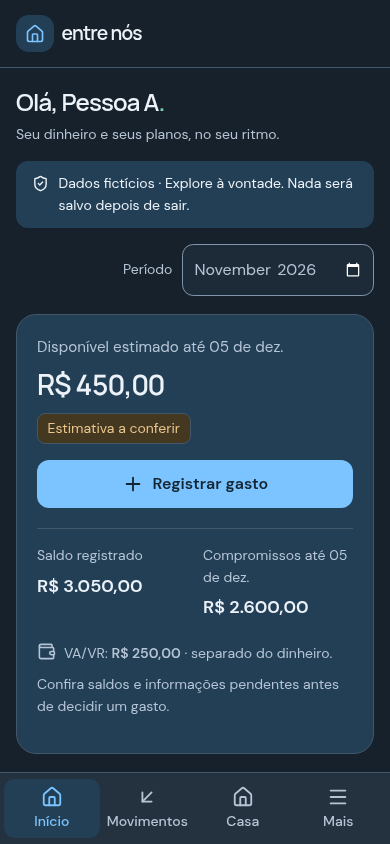
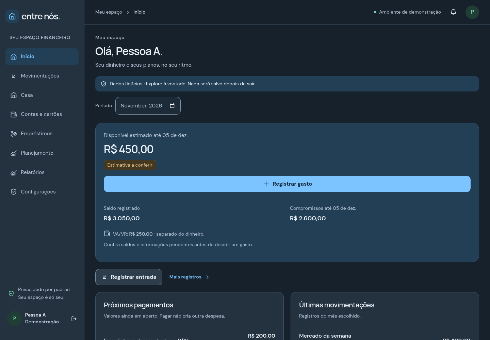

# Revisão de UI/UX mobile — Entre Nós

Revisão iniciada em 17/11 e retomada em 24/11/2026, horário de Brasília. Branch `feat/aplicativo-financas-familiares`; [PR #1](https://github.com/Mikhael-Fee/Gest-o-Financeira-Familiar/pull/1). Somente demonstração descartável e identidades fictícias de auditoria. A revisão preserva domínio financeiro, migrations, APIs, permissões e dados existentes. Não autoriza produção nem merge na main.

## 1. Diagnóstico anterior

A inspeção ocorreu na aplicação executada em Chromium, em 390 × 844 e 1440 × 1000, antes da edição. O desktop compartilhado não expôs ferramentas de interação nesta sessão; foram usados Playwright, screenshots reais e inspeção dos componentes existentes.

Encontramos fonte-base de 14 px, textos visíveis de até 8 px, 21 controles menores que 48 px na tela inicial mobile e 27 no desktop. A página inicial media 4.174 px no celular e 2.698 px no desktop. O detalhamento do disponível ocupava o início antes das ações frequentes. A navegação mobile tinha muitos destinos pequenos; compras simples expunham divisão de fontes, responsáveis e parcelamento de uma vez. Empréstimos, parcelas e recursos avançados competiam pela atenção.

As [medições anteriores](assets/ui-ux/antes/medidas.json) e as imagens abaixo documentam esses achados; não são wireframes.

## 2. Direção visual e design system

Superfícies em grafite e azul acinzentado, com elevação tonal, bordas discretas e pouco uso de sombra. A hierarquia se apoia em texto, espaçamento e ações identificadas. Não foi adicionada biblioteca de interface nem dependência.

`src/style.css` centraliza tokens de cor, tipografia, espaçamentos, campos, botões, foco, avisos, status, navegação, tabelas e modais. Componentes pequenos reúnem aparência, menu acessível, início pessoal, gastos progressivos e cartões. As preferências são escuro, claro ou sistema; texto padrão ou maior. O padrão inicial é escuro, mesmo quando o sistema está claro. A opção sistema acompanha suas alterações.

## 3. Paleta e contraste

| Token | Escuro | Claro |
|---|---|---|
| Fundo | `#17212B` | `#F3F6FA` |
| Superfície | `#243240` | `#FFFFFF` |
| Superfície elevada | `#2D3D4C` | `#E9EFF6` |
| Campo | `#1D2B38` | `#FFFFFF` |
| Texto | `#ECF2F8` | `#1C2C3A` |
| Texto secundário | `#B6C5D5` | `#455C70` |
| Destaque | `#7BC4FF` | `#185F91` |
| Confirmação | `#7ED1B1` | `#1C6A50` |
| Aviso | `#E8C58B` | `#7D4F05` |
| Erro | `#FFB4BD` | `#A12B3A` |
| Borda de controle | `#8095A9` | `#6B8094` |
| Foco | `#A8D9FF` | `#185F91` |

O cálculo usa luminância relativa sRGB da WCAG, sem arredondar antes da aprovação. São **82 combinações aprovadas**, incluindo fundos de avisos, botões, bordas, foco e seis cores de gráficos. Menor contraste textual calculado: **5,84:1 no escuro e 5,68:1 no claro**, acima de 4,5:1. Menor contraste dos elementos gráficos/controles verificados: **3,60:1 e 3,53:1**, acima de 3:1. Linhas decorativas não são usadas como única identificação de um controle.

| Combinação | Escuro | Claro |
|---|---|---|
| Texto / fundo | 14,45:1 | 13,17:1 |
| Texto / superfície | 11,60:1 | 14,28:1 |
| Secundário / superfície | 7,44:1 | 6,96:1 |
| Destaque / superfície | 6,97:1 | 6,81:1 |
| Texto do botão / destaque | 8,32:1 | 6,81:1 |
| Borda / campo | 4,67:1 | 4,09:1 |
| Foco / superfície elevada | 7,45:1 | 5,88:1 |

[Todas as combinações, valores e limites](assets/ui-ux/contrastes.json). Reproduzir com `npm run test:contrast`; a mesma checagem integra o CI. Axe complementa o cálculo nas telas renderizadas; sua aprovação não comprova acessibilidade integral.

## 4. Tipografia e toque

DM Sans para leitura e Manrope para títulos/valores, hospedadas no próprio artefato. Base relativa de 100% (normalmente 16 px); preferência maior de 112,5% (normalmente 18 px), respeitando a configuração do navegador. Textos auxiliares essenciais a partir de 0,875 rem (14/15,75 px); valores principais de aproximadamente 30–32 px quando há espaço. Entrelinhas de 1,5–1,6.

Botões têm área mínima de 3 rem (48 px com base padrão), campos de aproximadamente 52 px; checkbox de 24 px está dentro de rótulo acionável de pelo menos 48 px. Foco visível de 3 px. Links da navegação, sumários e fechar mantêm alvos grandes. Textos e controles podem quebrar linha. Zoom não foi desabilitado.

## 5. Navegação e início

No celular: **Início, Movimentos, Casa e Mais**. “Movimentos” é a legenda curta do destino Movimentações. Mais reúne contas/cartões, empréstimos, planejamento, relatórios, configurações e saída. Desktop mantém navegação lateral. Meu espaço abre primeiro; Início retorna à visão pessoal. Casa abre o contexto compartilhado. Movimentações, planejamento e relatórios mantêm indicação e troca explícita de visão.

O início mostra disponível estimado, saldo registrado, compromissos conhecidos e VA/VR separado. **Registrar gasto** fica junto do valor principal. Próximos pagamentos e últimas movimentações aparecem antes dos detalhes expansíveis. Pendências antigas e histórico desconhecido continuam sinalizados e acessíveis em todos os compromissos. A composição completa, conferência de saldos, previsões, alertas e contribuição foram preservadas em seções expansíveis.

## 6. Formulários progressivos

Compra simples começa com valor, descrição, categoria, forma, conta/cartão e data. A marcação Casa continua clara. “Mais opções” guarda parcelamento no crédito, quem comprou, responsabilidade, beneficiário, tags, duas fontes e divisão pessoal/Casa. VA/VR apresenta alimentação e contas compatíveis. Compra no crédito explica que entra na fatura sem saída bancária imediata.

Pagamento abre a obrigação existente com descrição, saldo em aberto, valor preenchido, data e conta. “Confirmar pagamento” aceita parcial, preserva o vencimento e usa o mesmo comando financeiro auditado, sem criar outra despesa. Erros permanecem no formulário com os campos preenchidos. Rodapé de salvar fica acessível por rolagem; em janela baixa, cabeçalho/rodapé deixam de ser fixos para não ocupar o campo inteiro.

Empréstimo conserva quantidade, valor, primeira data ou parcela conhecida, última paga e data real; histórico desconhecido não é quitado por inferência. CET, juros, cotação de quitação e renegociação permanecem nas opções de detalhamento. Cartão apresenta situação pelo calendário cadastrado, nunca como confirmação recebida do banco. Pix recebido, responsabilidade e pagamento da fatura continuam operações diferentes.

## 7. Iniciantes e cobertura das áreas

Guia existente e primeira conta continuam disponíveis. Rótulos de salário/recebimento usam “mês de referência”; mensagens explicam previsão, saldo não conferido, conta compartilhada sem responsável e diferença entre contribuição e consumo. Não existe modo por idade nem alteração de recursos por preferência visual.

Casa prioriza consumo compartilhado, contas abertas, minha contribuição e últimos pagamentos; meta flexível continua objetivo, sem dívida. Orçamentos, reservas, acertos, adiantamentos, importação, tags, convites e recuperação mantêm suas operações. Cartões e empréstimos ganharam resumos separados; calendário completo e compras/parcelas abrem sob demanda. Os seis gráficos mantêm seleção, filtros, valores, séries identificadas e tabela acessível; filtros avançados começam fechados e o mobile usa uma coluna.

## 8. Comparação visual

Imagens feitas na aplicação com dados fictícios. Antes: 17/11; depois: revisão atual. As medições da tela inicial usam 17/11/2026 como relógio de referência para a mesma demonstração e mês.

| Tela | Antes | Depois |
|---|---|---|
| Início mobile | [Imagem](assets/ui-ux/antes/mobile-inicio.png) | [Imagem](assets/ui-ux/mobile-inicio-depois.png) |
| Início desktop | [Imagem](assets/ui-ux/antes/desktop-inicio.png) | [Imagem](assets/ui-ux/desktop-inicio-depois.png) |
| Login mobile | [Imagem](assets/ui-ux/antes/mobile-login.png) | [Imagem](assets/ui-ux/depois/mobile-login.png) |
| Gasto mobile | [Imagem](assets/ui-ux/antes/mobile-gasto.png) | [Imagem](assets/ui-ux/depois/mobile-gasto.png) |
| Cartões | [Imagem](assets/ui-ux/antes/mobile-cartoes.png) | [Imagem](assets/ui-ux/depois/mobile-cartoes.png) |
| Empréstimos | [Planejamento anterior](assets/ui-ux/antes/mobile-emprestimos.png) | [Destino Empréstimos](assets/ui-ux/depois/mobile-emprestimos.png) |
| Casa | [Imagem](assets/ui-ux/antes/mobile-casa.png) | [Imagem](assets/ui-ux/depois/mobile-casa.png) |
| Relatórios | [Imagem](assets/ui-ux/antes/mobile-relatorios.png) | [Imagem](assets/ui-ux/depois/mobile-relatorios.png) |
| Configurações | [Imagem](assets/ui-ux/antes/mobile-configuracoes.png) | [Tema claro](assets/ui-ux/depois/mobile-configuracoes-claro.png) |

Medições finais: [arquivo JSON](assets/ui-ux/medidas-depois.json). Fonte mínima visível no início passou de 8 para 14 px; nenhum controle medido nessa tela ficou abaixo de 48 × 48 px. Altura do início: 4.174 → 1.982 px no mobile e 2.698 → 1.530 px no desktop, mantendo os detalhes acessíveis por expansão. A medição exclui conteúdo fechado/invisível; não é certificação de todos os alvos do aplicativo.

## 9. Testes e resultados

- Lint e TypeScript aprovados; build aprovado. O bundler mantém aviso de chunk principal acima de 500 kB; não bloqueia o build.
- **210/210 testes financeiros/de domínio**, em 24 arquivos, aprovados novamente. Incluem PostgreSQL/PGlite, precisão em centavos, pagamentos, atribuição, históricos, permissões e regressões anteriores.
- Contraste: **82/82 combinações aprovadas**.
- **79/79 testes de navegador aprovados**, incluindo 12 novos casos (seis em cada projeto desktop/mobile). Autenticação, PWA offline, erros preservando formulário, compra parcelada, VA, pagamento parcial, contribuição/Casa, histórico, anulação, orçamentos, metas, salário, gráficos, teclado e saída foram exercitados. O teste de foco inclui 320 × 430, texto a 200%, menu, formulário e escala visual 2 no Chromium.
- Varredura das seis larguras, claro/escuro e texto padrão/maior: **380 estados**, mais **64 verificações em 320 px após o ajuste de reflow**, total de **444 verificações sem violações Axe ou transbordamento horizontal**. [Resumo das evidências](assets/ui-ux/verificacao-visual.json).
- Orientação horizontal e janela baixa: **844 × 390, 844 × 220 e 320 × 430**, com texto a **200%**, campo focado integralmente dentro do modal e salvamento operável. Os dois testes de navegador que incorporam esses casos passaram após a correção. A altura de 220 px é simulação de área reduzida, não teste de teclado físico/virtual real.

`npm run test:e2e -- --workers=2` inclui autenticação interceptada especificamente na suíte de Auth, demonstração em memória nas demais jornadas e PWA em build. Não confundir essas suítes com a homologação autenticada real. `scripts/verify-ui-browser.mjs`, acionado explicitamente pelo operador com fixture privada, verifica a jornada pública sem interceptar o backend, usando somente a família fictícia da auditoria.

Reproduzir visualmente: iniciar `npm run dev` sem credenciais para demonstração e executar `npm run test:ui`. O script aceita larguras 320, 360, 390, 430, 768 e 1440, temas claro/escuro e texto padrão/maior. Resultados ficam em `.cache/ui-ux-audit`, ignorada pelo Git. Capturas opcionais usam `UI_CAPTURE=1`. Credenciais e evidências autenticadas ficam fora do checkout.

## 10. Problemas corrigidos durante a verificação

Além da densidade original, corrigimos transbordamento com fonte a 200% em 320 px (cabeçalho, seletor de mês e rótulos longos), foco que escapava do último item do menu modal, rodapé/cabeçalho que ocupavam espaço excessivo em janela baixa, rolagem que cortava parte do campo focado com texto ampliado, quebra de palavra no botão Adicionar, estado visual ambíguo em cobranças inativas e seletores E2E antigos que pressupunham a navegação anterior. Em janela baixa, o modal reduz o espaço reservado para barras fixas e revela o campo após o foco e a mudança da área visual. Os testes financeiros mantiveram as expectativas; as adaptações de navegação aguardam título/rota para evitar corridas.

## 11. Limites e pendências

Não houve teste com familiares reais nem certificação WCAG. A inspeção heurística considera tarefas de iniciantes, mas não mede aprendizado humano. Faltam ensaios em aparelhos físicos Android/iOS, VoiceOver/TalkBack/NVDA, teclado virtual e safe areas de modelos reais. O código considera `visualViewport`, alturas dinâmicas, `env(safe-area-inset-*)`, fontes relativas, movimento reduzido e alto contraste; emulação não substitui esses ensaios.

Há verificações de texto a 200%, largura de 320 px, janela baixa/paisagem e escala visual do Chromium. Isso não comprova todos os mecanismos de zoom de cada navegador/SO. A resposta de leitores de tela reais continua pendente, embora nomes, labels, tabelas, landmarks e foco sejam verificados automaticamente e por teclado.

O aviso de bundle acima de 500 kB permanece como oportunidade de otimização. Não foram reaplicadas migrations nem repetidos testes pgTAP remotos por motivo visual; os resultados históricos estão no relatório financeiro, separados desta execução.

## 12. Arquivos alterados

Apresentação: `src/style.css`, `src/App.tsx`, `src/main.tsx`, `index.html`, manifest; componentes `AppearanceSettings`, `AccessibleDialog`, `dialogFocus`, `FinancialHome`, `ExpenseFields`, `CreditCards`, `ReportCharts`, `Reports` e `ui`. Ajustes exclusivamente textuais em `Onboarding`, `SalaryPanel` e `AvailabilityPanel`.

Validação: testes E2E existentes e novos `helpers.ts`/`mobile-ux.spec.ts`; scripts de contraste, inspeção visual e navegação pública, verificadores de browser atualizados e novo `verify-ui-browser.mjs`; comandos npm e checagem de contraste no CI. Documentação e imagens neste relatório. Nenhuma mudança em `src/domain`, `src/data`, `server` ou `supabase`.

## 13. Histórico, PR e commit

[PR #1](https://github.com/Mikhael-Fee/Gest-o-Financeira-Familiar/pull/1), preservando todos os commits anteriores. Interface em [`0f7d9b0`](https://github.com/Mikhael-Fee/Gest-o-Financeira-Familiar/commit/0f7d9b0f707edae78db5db7b00e110b0e7dda90b), com [CI aprovado](https://github.com/Mikhael-Fee/Gest-o-Financeira-Familiar/actions/runs/45413022339). A correção adicional de foco em janela baixa aguarda seu próprio CI antes da publicação. Não houve merge na main.

## 14. Homologação e disponibilidade

[Site de homologação existente](https://entre-nos-homologacao.netlify.app). Publicação desta revisão condicionada a CI aprovado; ainda não executada neste ponto do relatório.

Em 24/11, a pedido do usuário, foi verificado o Supabase existente `ovoqhnoaigjzihhpdukn`: Management API informou `ACTIVE_HEALTHY`; saúde de Auth, login fictício e RPC autorizada `load_finances` retornaram 200, logout 204 e site 200. Não foi necessário restaurar/reativar o projeto nem alterar sua configuração. Grupo de Louvor fora do escopo e sem alterações.
